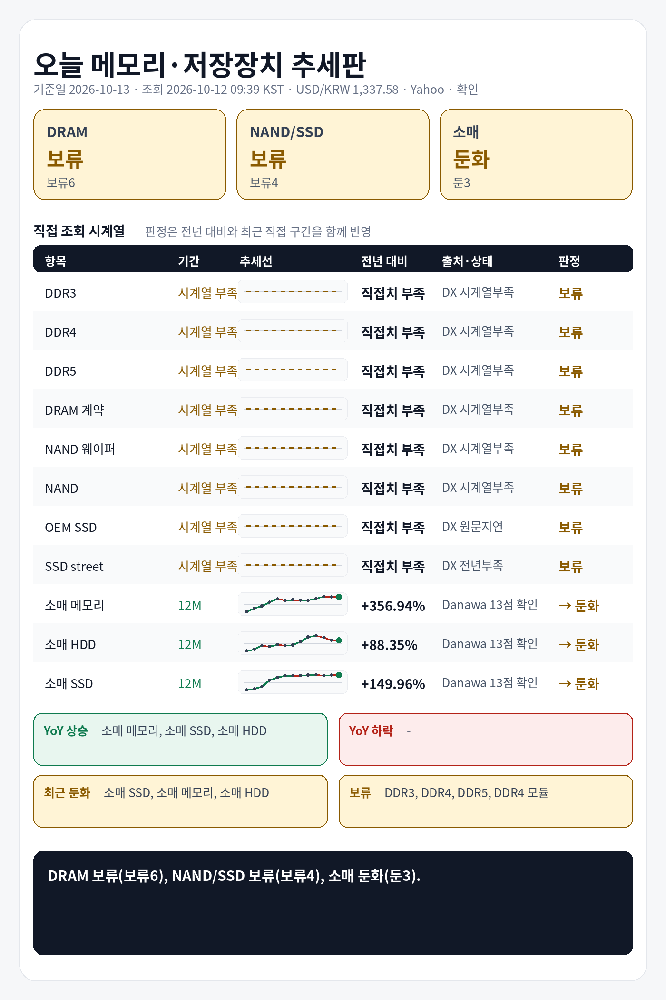

## 1. 기준 환율 1줄
USD/KRW: 1,337.58원 (조회 2026-10-12 09:39 KST, 출처 Yahoo Finance USDKRW=X, 원문 Last Update 2026-10-12 09:39 KST, 상태 확인, 전일 대비 -0.46%).

## 2. 오늘 한눈에 추세판
| 구분 | 현재값 | 전일 | 전주 | 전월 | 전년 | 추세 | 판정 |
|---|---:|---|---|---|---|---|---|
| DDR3 칩 | 확인 불가 | 확인 불가 | 확인 불가 | 확인 불가 | 현재 직접치 부족 | 확인 불가 | 판단 보류 |
| DDR4 칩 | 확인 불가 | 확인 불가 | 확인 불가 | 확인 불가 | 현재 직접치 부족 | 확인 불가 | 판단 보류 |
| DDR5 칩 | 확인 불가 | 확인 불가 | 확인 불가 | 확인 불가 | 현재 직접치 부족 | 확인 불가 | 판단 보류 |
| DDR4 모듈 | 확인 불가 | 확인 불가 | 확인 불가 | 확인 불가 | 현재 직접치 부족 | 확인 불가 | 판단 보류 |
| DDR5 모듈 | 확인 불가 | 확인 불가 | 확인 불가 | 확인 불가 | 현재 직접치 부족 | 확인 불가 | 판단 보류 |
| DRAM 계약가 | 확인 불가 | 확인 불가 | 확인 불가 | 확인 불가 | 현재 직접치 부족 | 확인 불가 | 판단 보류 |
| NAND 웨이퍼 | 확인 불가 | 확인 불가 | 확인 불가 | 확인 불가 | 현재 직접치 부족 | 확인 불가 | 판단 보류 |
| NAND 계약가 | 확인 불가 | 확인 불가 | 확인 불가 | 확인 불가 | 현재 직접치 부족 | 확인 불가 | 판단 보류 |
| PC-client OEM SSD 계약가 | 확인 불가 | 확인 불가 | 확인 불가 | 확인 불가 | 현재 직접치 부족 | 확인 불가 | 판단 보류 |
| SSD street price | 확인 불가 | 확인 불가 | 확인 불가 | 확인 불가 | 현재 직접치 부족 | 확인 불가 | 판단 보류 |
| 소매 메모리 (삼성전자 DDR5-5600 32GB) | 790,970원 | 확인 불가 | 확인 불가 | 확인 불가 | 전년 대비 +356.94% · 전년값 25-10 월간 가격추이 · 출처 Danawa 가격추이 24개월 · 삼성전자 DDR5-5600 32GB | 전년 상승, 최근 직접구간 -0.37% | 둔화 |
| 소매 HDD (Seagate BarraCuda 8TB) | 398,980원 | 확인 불가 | 확인 불가 | 확인 불가 | 전년 대비 +88.35% · 전년값 25-10 월간 가격추이 · 출처 Danawa 가격추이 24개월 · Seagate BarraCuda 8TB | 전년 상승, 최근 직접구간 -0.01% | 둔화 |
| 소매 SSD (Samsung 990 PRO 1TB) | 392,830원 | 확인 불가 | 확인 불가 | 확인 불가 | 전년 대비 +149.96% · 전년값 25-10 월간 가격추이 · 출처 Danawa 가격추이 24개월 · Samsung 990 PRO 1TB | 전년 상승, 최근 직접구간 -0.77% | 둔화 |

## 3. 상승·하락 요약 4줄
상승: 확인 불가
하락/둔화: 소매 메모리 둔화(+356.94% YoY, 최근 -0.37%), 소매 SSD 둔화(+149.96% YoY, 최근 -0.77%), 소매 HDD 둔화(+88.35% YoY, 최근 -0.01%)
전년: 소매 메모리 +356.94%, 소매 HDD +88.35%, 소매 SSD +149.96%
보류: DDR3 칩, DDR4 칩, DDR5 칩, DDR4 모듈, DDR5 모듈, DRAM 계약가, NAND 웨이퍼, NAND 계약가

## 4. 가격표
| 항목 | 현재값 | 조회 시각·출처·상태 | 원문 Last Update | 전월 대비 | 전년 대비 | 추세 |
|---|---:|---|---|---|---|---|
| DDR3 칩 | 확인 불가 | 2026-10-12 09:39 KST · DRAMeXchange 공개표 (https://www.dramexchange.com/) · 상태 확인 불가 | 확인 불가 | 확인 불가 | 현재 직접치 부족 | 확인 불가 |
| DDR4 칩 | 확인 불가 | 2026-10-12 09:39 KST · DRAMeXchange 공개표 (https://www.dramexchange.com/) · 상태 확인 불가 | 확인 불가 | 확인 불가 | 현재 직접치 부족 | 확인 불가 |
| DDR5 칩 | 확인 불가 | 2026-10-12 09:39 KST · DRAMeXchange 공개표 (https://www.dramexchange.com/) · 상태 확인 불가 | 확인 불가 | 확인 불가 | 현재 직접치 부족 | 확인 불가 |
| DDR4 모듈 | 확인 불가 | 2026-10-12 09:39 KST · DRAMeXchange 공개표 (https://www.dramexchange.com/) · 상태 확인 불가 | 확인 불가 | 확인 불가 | 현재 직접치 부족 | 확인 불가 |
| DDR5 모듈 | 확인 불가 | 2026-10-12 09:39 KST · DRAMeXchange 공개표 (https://www.dramexchange.com/) · 상태 확인 불가 | 확인 불가 | 확인 불가 | 현재 직접치 부족 | 확인 불가 |
| DRAM 계약가 | 확인 불가 | 2026-10-12 09:39 KST · DRAMeXchange HomePrice NationalDramContract (https://www.dramexchange.com/Price/NationalContractDramDetail) · 상태 확인 불가 | 확인 불가 | 확인 불가 | 현재 직접치 부족 | 확인 불가 |
| NAND 웨이퍼 | 확인 불가 | 2026-10-12 09:39 KST · DRAMeXchange 공개표 (https://www.dramexchange.com/) · 상태 확인 불가 | 확인 불가 | 확인 불가 | 현재 직접치 부족 | 확인 불가 |
| NAND 계약가 | 확인 불가 | 2026-10-12 09:39 KST · DRAMeXchange HomePrice NationalFlashContract (https://www.dramexchange.com/Price/NationalContractFlashDetail) · 상태 확인 불가 | 확인 불가 | 확인 불가 | 현재 직접치 부족 | 확인 불가 |
| PC-client OEM SSD 계약가 | 확인 불가 | 2026-10-12 09:39 KST · DRAMeXchange HomePrice PCC (https://www.dramexchange.com/Price/PCClientOEMSSD) · 상태 확인 불가 | 확인 불가 | 확인 불가 | 현재 직접치 부족 | 확인 불가 |
| SSD street price | 확인 불가 | 2026-10-12 09:39 KST · DRAMeXchange HomePrice SSD (https://www.dramexchange.com/Price/SSD_Street) · 상태 확인 불가 | 확인 불가 | 확인 불가 | 현재 직접치 부족 | 확인 불가 |
| 소매 메모리 (삼성전자 DDR5-5600 32GB) | 790,970원 | 2026-10-12 09:39 KST · Danawa prod 가격비교 · 삼성전자 DDR5-5600 32GB (https://prod.danawa.com/info/?pcode=20644043) · 상태 확인 | 상품 페이지 직접 조회, 원문 Last Update 별도 없음 | 확인 불가 | 전년 대비 +356.94% · 전년값 25-10 월간 가격추이 · 출처 Danawa 가격추이 24개월 · 삼성전자 DDR5-5600 32GB | 비교 기준값 확인 불가 |
| 소매 HDD (Seagate BarraCuda 8TB) | 398,980원 | 2026-10-12 09:39 KST · Danawa prod 가격비교 · Seagate BarraCuda 8TB (https://prod.danawa.com/info/?pcode=5764992) · 상태 확인 | 상품 페이지 직접 조회, 원문 Last Update 별도 없음 | 확인 불가 | 전년 대비 +88.35% · 전년값 25-10 월간 가격추이 · 출처 Danawa 가격추이 24개월 · Seagate BarraCuda 8TB | 비교 기준값 확인 불가 |
| 소매 SSD (Samsung 990 PRO 1TB) | 392,830원 | 2026-10-12 09:39 KST · Danawa prod 가격비교 · Samsung 990 PRO 1TB (https://prod.danawa.com/info/?pcode=18297002) · 상태 확인 | 상품 페이지 직접 조회, 원문 Last Update 별도 없음 | 확인 불가 | 전년 대비 +149.96% · 전년값 25-10 월간 가격추이 · 출처 Danawa 가격추이 24개월 · Samsung 990 PRO 1TB | 비교 기준값 확인 불가 |

## 5. 마지막 한 줄
전년 기준으로 가장 강한 쪽은 소매 메모리, 가장 약한 쪽은 소매 HDD, DRAM 전년+최근 판정은 보류(보류6), NAND/SSD 전년+최근 판정은 보류(보류4), 소매 전년+최근 판정은 둔화(둔3).

## 6. 마지막 이미지형 요약판

