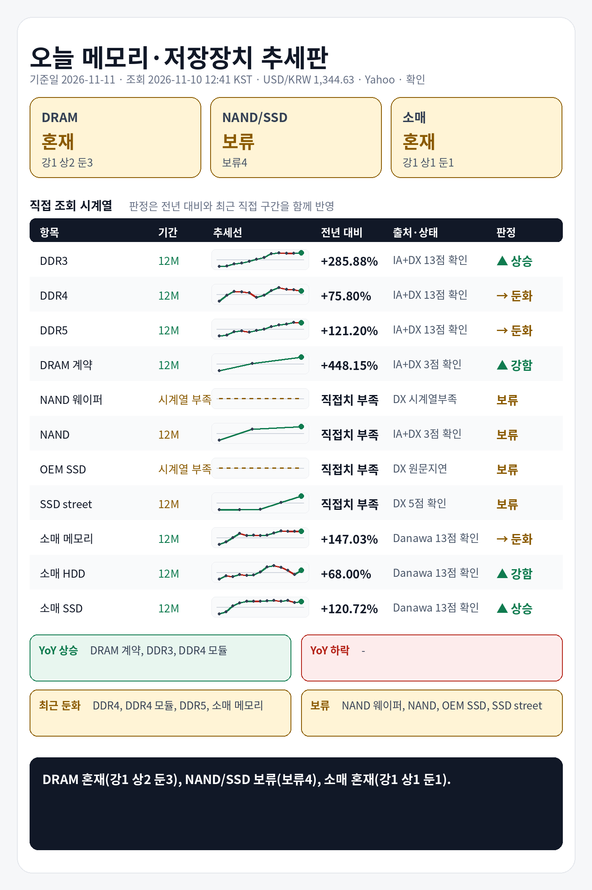

## 1. 기준 환율 1줄
USD/KRW: 1,344.63원 (조회 2026-11-10 12:41 KST, 출처 Yahoo Finance USDKRW=X, 원문 Last Update 2026-11-10 12:41 KST, 상태 확인, 전일 대비 +0.13%).

## 2. 오늘 한눈에 추세판
| 구분 | 현재값 | 전일 | 전주 | 전월 | 전년 | 추세 | 판정 |
|---|---:|---|---|---|---|---|---|
| DDR3 칩 | $13.830 (약 18,596원) | 공개 변화율 +0.00% | 확인 불가 | 확인 불가 | 전년 대비 +285.88% · 전년값 캡처 2025-12-04 05:06 KST, 항목 DDR3 4Gb 512Mx8 1600/1866 · 출처 Internet Archive DRAMeXchange 공개표 캡처 | 전년 상승, 최근 직접구간 +0.57% | 상승 |
| DDR4 칩 | $79.990 (약 107,557원) | 공개 변화율 -0.31% | 확인 불가 | 확인 불가 | 전년 대비 +75.80% · 전년값 캡처 2025-12-04 05:06 KST, 항목 DDR4 16Gb (2Gx8)3200 · 출처 Internet Archive DRAMeXchange 공개표 캡처 | 전년 상승, 최근 직접구간 -4.05% | 둔화 |
| DDR5 칩 | $60.167 (약 80,902원) | 공개 변화율 +0.00% | 확인 불가 | 확인 불가 | 전년 대비 +121.20% · 전년값 캡처 2025-12-04 05:06 KST, 항목 DDR5 16G (2Gx8) 4800/5600 · 출처 Internet Archive DRAMeXchange 공개표 캡처 | 전년 상승, 최근 직접구간 -0.88% | 둔화 |
| DDR4 모듈 | $164.200 (약 220,788원) | 확인 불가 | 공개 변화율 +0.00% | 확인 불가 | 전년 대비 +226.88% · 전년값 캡처 2025-11-24 22:41 KST, 항목 DDR4 UDIMM 16GB 3200 · 출처 Internet Archive DRAMeXchange 공개표 캡처 | 전년 상승, 최근 직접구간 -1.02% | 둔화 |
| DDR5 모듈 | $243.333 (약 327,193원) | 확인 불가 | 공개 변화율 +0.69% | 확인 불가 | 전년 대비 +142.12% · 전년값 캡처 2025-11-24 22:41 KST, 항목 DDR5 UDIMM 16GB 4800/5600 · 출처 Internet Archive DRAMeXchange 공개표 캡처 | 전년 상승, 최근 직접구간 +1.81% | 상승 |
| DRAM 계약가 (DDR4 8GB SO-DIMM) | $148.000 (약 199,005원) | 확인 불가 | 확인 불가 | 공개 변화율 +4.23%, 기준값 확인 불가 | 전년 대비 +448.15% · 전년값 원문 2025-09-30 16:00:00, 캡처 2025-11-12 00:32 KST · 출처 Internet Archive DRAMeXchange HomePrice NationalDramContract 캡처 | 전년 상승, 최근 직접구간 +24.37% | 강함 |
| NAND 웨이퍼 | 확인 불가 | 확인 불가 | 확인 불가 | 확인 불가 | 현재 직접치 부족 | 확인 불가 | 판단 보류 |
| NAND 계약가 (NAND 128Gb 16Gx8 Speedns) | $30.608 (약 41,156원) | 확인 불가 | 확인 불가 | 공개 변화율 +0.44%, 기준값 확인 불가 | 전년 직접치 부족 | 공개 변화율 +0.44% 기준 보합 | 판단 보류 |
| PC-client OEM SSD 계약가 (1TB-mSATA/M.2 TLC PCIe-Value Grade) | 지연/불일치 있음 | 확인 불가 | 확인 불가 | 지연/불일치 있음 | 현재 직접치 부족 | 지연/불일치 있음 | 판단 보류 |
| SSD street price (990 Pro) | $259.915 (약 349,490원) | 확인 불가 | 확인 불가 | 공개 변화율 +3.97%, 기준값 확인 불가 | 전년 직접치 부족 | 공개 변화율 +3.97% 기준 상승 | 판단 보류 |
| 소매 메모리 (삼성전자 DDR5-5600 32GB) | 788,020원 | 확인 불가 | 확인 불가 | 확인 불가 | 전년 대비 +147.03% · 전년값 25-11 월간 가격추이 · 출처 Danawa 가격추이 24개월 · 삼성전자 DDR5-5600 32GB | 전년 상승, 최근 직접구간 -0.37% | 둔화 |
| 소매 HDD (Seagate BarraCuda 8TB) | 399,000원 | 확인 불가 | 확인 불가 | 확인 불가 | 전년 대비 +68.00% · 전년값 25-11 월간 가격추이 · 출처 Danawa 가격추이 24개월 · Seagate BarraCuda 8TB | 전년 상승, 최근 직접구간 +24.69% | 강함 |
| 소매 SSD (Samsung 990 PRO 1TB) | 379,630원 | 확인 불가 | 확인 불가 | 확인 불가 | 전년 대비 +120.72% · 전년값 25-11 월간 가격추이 · 출처 Danawa 가격추이 24개월 · Samsung 990 PRO 1TB | 전년 상승, 최근 직접구간 +3.73% | 상승 |

## 3. 상승·하락 요약 4줄
상승: DRAM 계약가 강함(+448.15% YoY, 최근 +24.37%), DDR3 칩 상승(+285.88% YoY, 최근 +0.57%), DDR5 모듈 상승(+142.12% YoY, 최근 +1.81%), 소매 SSD 상승(+120.72% YoY, 최근 +3.73%), 소매 HDD 강함(+68.00% YoY, 최근 +24.69%)
하락/둔화: DDR4 모듈 둔화(+226.88% YoY, 최근 -1.02%), 소매 메모리 둔화(+147.03% YoY, 최근 -0.37%), DDR5 칩 둔화(+121.20% YoY, 최근 -0.88%), DDR4 칩 둔화(+75.80% YoY, 최근 -4.05%)
전년: DDR3 칩 +285.88%, DDR4 칩 +75.80%, DDR5 칩 +121.20%, DDR4 모듈 +226.88%, DDR5 모듈 +142.12%, DRAM 계약가 +448.15%
보류: NAND 웨이퍼, NAND 계약가, PC-client OEM SSD 계약가, SSD street price

## 4. 가격표
| 항목 | 현재값 | 조회 시각·출처·상태 | 원문 Last Update | 전월 대비 | 전년 대비 | 추세 |
|---|---:|---|---|---|---|---|
| DDR3 칩 | $13.830 (약 18,596원) | 2026-11-10 12:41 KST · DRAMeXchange 공개표 (https://www.dramexchange.com/Price/Dram_Spot) · 상태 확인 | 홈 공개표, 원문 Last Update 별도 없음, 항목 DDR3 4Gb 512Mx8 1600/1866 | 확인 불가 | 전년 대비 +285.88% · 전년값 캡처 2025-12-04 05:06 KST, 항목 DDR3 4Gb 512Mx8 1600/1866 · 출처 Internet Archive DRAMeXchange 공개표 캡처 | 공개 변화율 +0.00% 기준 보합 |
| DDR4 칩 | $79.990 (약 107,557원) | 2026-11-10 12:41 KST · DRAMeXchange 공개표 (https://www.dramexchange.com/Price/Dram_Spot) · 상태 확인 | 홈 공개표, 원문 Last Update 별도 없음, 항목 DDR4 16Gb (2Gx8) 3200 | 확인 불가 | 전년 대비 +75.80% · 전년값 캡처 2025-12-04 05:06 KST, 항목 DDR4 16Gb (2Gx8)3200 · 출처 Internet Archive DRAMeXchange 공개표 캡처 | 공개 변화율 -0.31% 기준 보합 |
| DDR5 칩 | $60.167 (약 80,902원) | 2026-11-10 12:41 KST · DRAMeXchange 공개표 (https://www.dramexchange.com/Price/Dram_Spot) · 상태 확인 | 홈 공개표, 원문 Last Update 별도 없음, 항목 DDR5 16Gb (2Gx8) 4800/5600 | 확인 불가 | 전년 대비 +121.20% · 전년값 캡처 2025-12-04 05:06 KST, 항목 DDR5 16G (2Gx8) 4800/5600 · 출처 Internet Archive DRAMeXchange 공개표 캡처 | 공개 변화율 +0.00% 기준 보합 |
| DDR4 모듈 | $164.200 (약 220,788원) | 2026-11-10 12:41 KST · DRAMeXchange 공개표 (https://www.dramexchange.com/Price/Module_Spot) · 상태 확인 | 홈 공개표, 원문 Last Update 별도 없음, 항목 DDR4 UDIMM 16GB 3200 | 확인 불가 | 전년 대비 +226.88% · 전년값 캡처 2025-11-24 22:41 KST, 항목 DDR4 UDIMM 16GB 3200 · 출처 Internet Archive DRAMeXchange 공개표 캡처 | 공개 변화율 +0.00% 기준 보합 |
| DDR5 모듈 | $243.333 (약 327,193원) | 2026-11-10 12:41 KST · DRAMeXchange 공개표 (https://www.dramexchange.com/Price/Module_Spot) · 상태 확인 | 홈 공개표, 원문 Last Update 별도 없음, 항목 DDR5 UDIMM 16GB 4800/5600 | 확인 불가 | 전년 대비 +142.12% · 전년값 캡처 2025-11-24 22:41 KST, 항목 DDR5 UDIMM 16GB 4800/5600 · 출처 Internet Archive DRAMeXchange 공개표 캡처 | 공개 변화율 +0.69% 기준 상승 |
| DRAM 계약가 (DDR4 8GB SO-DIMM) | $148.000 (약 199,005원) | 2026-11-10 12:41 KST · DRAMeXchange HomePrice NationalDramContract (https://www.dramexchange.com/Price/NationalContractDramDetail) · 상태 확인 | 2026-09-30 17:00:00 | 공개 변화율 +4.23%, 기준값 확인 불가 | 전년 대비 +448.15% · 전년값 원문 2025-09-30 16:00:00, 캡처 2025-11-12 00:32 KST · 출처 Internet Archive DRAMeXchange HomePrice NationalDramContract 캡처 | 공개 변화율 +4.23% 기준 상승 |
| NAND 웨이퍼 | 확인 불가 | 2026-11-10 12:41 KST · DRAMeXchange 공개표 (https://www.dramexchange.com/) · 상태 확인 불가 | 확인 불가 | 확인 불가 | 현재 직접치 부족 | 확인 불가 |
| NAND 계약가 (NAND 128Gb 16Gx8 Speedns) | $30.608 (약 41,156원) | 2026-11-10 12:41 KST · DRAMeXchange HomePrice NationalFlashContract (https://www.dramexchange.com/Price/NationalContractFlashDetail) · 상태 확인 | 2026-09-30 10:00:00 | 공개 변화율 +0.44%, 기준값 확인 불가 | 전년 직접치 부족 | 공개 변화율 +0.44% 기준 보합 |
| PC-client OEM SSD 계약가 (1TB-mSATA/M.2 TLC PCIe-Value Grade) | 지연/불일치 있음 | 2026-11-10 12:41 KST · DRAMeXchange HomePrice PCC (https://www.dramexchange.com/Price/PCClientOEMSSD) · 상태 지연/불일치 있음 | 2026-08-05 11:00:00 | 지연/불일치 있음 | 현재 직접치 부족 | 지연/불일치 있음 |
| SSD street price (990 Pro) | $259.915 (약 349,490원) | 2026-11-10 12:41 KST · DRAMeXchange HomePrice SSD (https://www.dramexchange.com/Price/SSD_Street) · 상태 확인 | 2026-10-30 11:30:00 | 공개 변화율 +3.97%, 기준값 확인 불가 | 전년 직접치 부족 | 공개 변화율 +3.97% 기준 상승 |
| 소매 메모리 (삼성전자 DDR5-5600 32GB) | 788,020원 | 2026-11-10 12:41 KST · Danawa prod 가격비교 · 삼성전자 DDR5-5600 32GB (https://prod.danawa.com/info/?pcode=20644043) · 상태 확인 | 상품 페이지 직접 조회, 원문 Last Update 별도 없음 | 확인 불가 | 전년 대비 +147.03% · 전년값 25-11 월간 가격추이 · 출처 Danawa 가격추이 24개월 · 삼성전자 DDR5-5600 32GB | 비교 기준값 확인 불가 |
| 소매 HDD (Seagate BarraCuda 8TB) | 399,000원 | 2026-11-10 12:41 KST · Danawa prod 가격비교 · Seagate BarraCuda 8TB (https://prod.danawa.com/info/?pcode=5764992) · 상태 확인 | 상품 페이지 직접 조회, 원문 Last Update 별도 없음 | 확인 불가 | 전년 대비 +68.00% · 전년값 25-11 월간 가격추이 · 출처 Danawa 가격추이 24개월 · Seagate BarraCuda 8TB | 비교 기준값 확인 불가 |
| 소매 SSD (Samsung 990 PRO 1TB) | 379,630원 | 2026-11-10 12:41 KST · Danawa prod 가격비교 · Samsung 990 PRO 1TB (https://prod.danawa.com/info/?pcode=18297002) · 상태 확인 | 상품 페이지 직접 조회, 원문 Last Update 별도 없음 | 확인 불가 | 전년 대비 +120.72% · 전년값 25-11 월간 가격추이 · 출처 Danawa 가격추이 24개월 · Samsung 990 PRO 1TB | 비교 기준값 확인 불가 |

## 5. 마지막 한 줄
전년 기준으로 가장 강한 쪽은 DRAM 계약가, 가장 약한 쪽은 소매 HDD, DRAM 전년+최근 판정은 혼재(강1 상2 둔3), NAND/SSD 전년+최근 판정은 보류(보류4), 소매 전년+최근 판정은 혼재(강1 상1 둔1).

## 6. 마지막 이미지형 요약판

