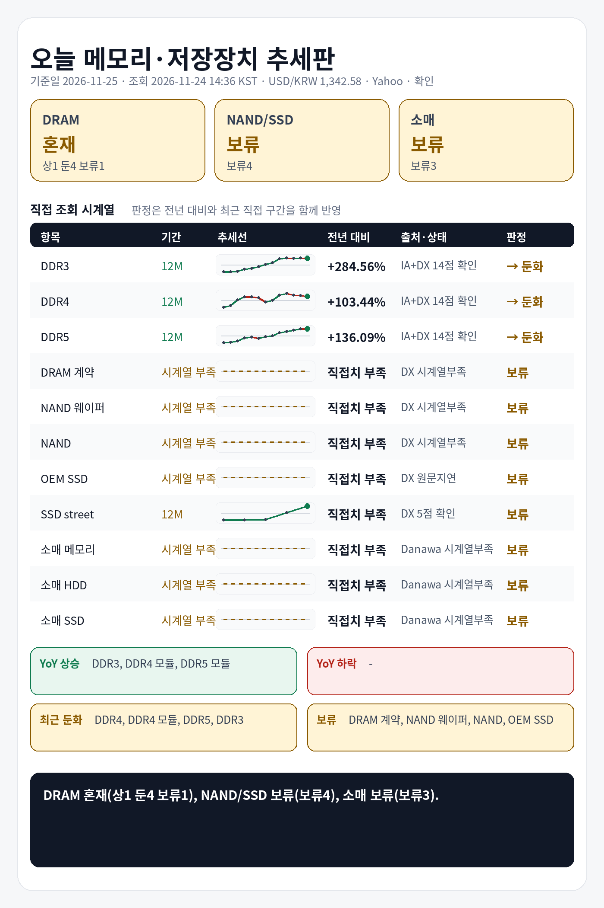

## 1. 기준 환율 1줄
USD/KRW: 1,342.58원 (조회 2026-11-24 14:36 KST, 출처 Yahoo Finance USDKRW=X, 원문 Last Update 2026-11-24 14:36 KST, 상태 확인, 전일 대비 +0.72%).

## 2. 오늘 한눈에 추세판
| 구분 | 현재값 | 전일 | 전주 | 전월 | 전년 | 추세 | 판정 |
|---|---:|---|---|---|---|---|---|
| DDR3 칩 | $13.771 (약 18,489원) | 공개 변화율 +0.00% | 확인 불가 | 확인 불가 | 전년 대비 +284.56% · 전년값 캡처 2025-11-24 22:41 KST, 원문 Last Update 별도 없음, 항목 DDR3 4Gb 512Mx8 1600/1866 · 출처 Internet Archive DRAMeXchange 공개표 캡처 | 전년 상승, 최근 직접구간 -0.51% | 둔화 |
| DDR4 칩 | $78.375 (약 105,225원) | 공개 변화율 -0.16% | 확인 불가 | 확인 불가 | 전년 대비 +103.44% · 전년값 캡처 2025-11-24 22:41 KST, 원문 Last Update 별도 없음, 항목 DDR4 16Gb (2Gx8)3200 · 출처 Internet Archive DRAMeXchange 공개표 캡처 | 전년 상승, 최근 직접구간 -5.42% | 둔화 |
| DDR5 칩 | $60.833 (약 81,673원) | 공개 변화율 +0.22% | 확인 불가 | 확인 불가 | 전년 대비 +136.09% · 전년값 캡처 2025-11-24 22:41 KST, 원문 Last Update 별도 없음, 항목 DDR5 16G (2Gx8) 4800/5600 · 출처 Internet Archive DRAMeXchange 공개표 캡처 | 전년 상승, 최근 직접구간 -0.71% | 둔화 |
| DDR4 모듈 | $163.366 (약 219,332원) | 확인 불가 | 공개 변화율 -0.48% | 확인 불가 | 전년 대비 +225.22% · 전년값 캡처 2025-11-24 22:41 KST, 원문 Last Update 별도 없음, 항목 DDR4 UDIMM 16GB 3200 · 출처 Internet Archive DRAMeXchange 공개표 캡처 | 전년 상승, 최근 직접구간 -1.53% | 둔화 |
| DDR5 모듈 | $244.333 (약 328,037원) | 확인 불가 | 공개 변화율 -0.27% | 확인 불가 | 전년 대비 +143.12% · 전년값 캡처 2025-11-24 22:41 KST, 원문 Last Update 별도 없음, 항목 DDR5 UDIMM 16GB 4800/5600 · 출처 Internet Archive DRAMeXchange 공개표 캡처 | 전년 상승, 최근 직접구간 +2.23% | 상승 |
| DRAM 계약가 (DDR4 8GB SO-DIMM) | 지연/불일치 있음 | 확인 불가 | 확인 불가 | 지연/불일치 있음 | 현재 직접치 부족 | 지연/불일치 있음 | 판단 보류 |
| NAND 웨이퍼 | 확인 불가 | 확인 불가 | 확인 불가 | 확인 불가 | 현재 직접치 부족 | 확인 불가 | 판단 보류 |
| NAND 계약가 (NAND 128Gb 16Gx8 Speedns) | 지연/불일치 있음 | 확인 불가 | 확인 불가 | 지연/불일치 있음 | 현재 직접치 부족 | 지연/불일치 있음 | 판단 보류 |
| PC-client OEM SSD 계약가 (1TB-mSATA/M.2 TLC PCIe-Value Grade) | 지연/불일치 있음 | 확인 불가 | 확인 불가 | 지연/불일치 있음 | 현재 직접치 부족 | 지연/불일치 있음 | 판단 보류 |
| SSD street price (990 Pro) | $259.990 (약 349,057원) | 확인 불가 | 확인 불가 | 공개 변화율 +0.03%, 기준값 확인 불가 | 전년 직접치 부족 | 공개 변화율 +0.03% 기준 보합 | 판단 보류 |
| 소매 메모리 | 확인 불가: HTTPError | 확인 불가 | 확인 불가 | 확인 불가 | 현재 직접치 부족 | 확인 불가: HTTPError | 판단 보류 |
| 소매 HDD | 확인 불가: HTTPError | 확인 불가 | 확인 불가 | 확인 불가 | 현재 직접치 부족 | 확인 불가: HTTPError | 판단 보류 |
| 소매 SSD | 확인 불가: HTTPError | 확인 불가 | 확인 불가 | 확인 불가 | 현재 직접치 부족 | 확인 불가: HTTPError | 판단 보류 |

## 3. 상승·하락 요약 4줄
상승: DDR5 모듈 상승(+143.12% YoY, 최근 +2.23%)
하락/둔화: DDR3 칩 둔화(+284.56% YoY, 최근 -0.51%), DDR4 모듈 둔화(+225.22% YoY, 최근 -1.53%), DDR5 칩 둔화(+136.09% YoY, 최근 -0.71%), DDR4 칩 둔화(+103.44% YoY, 최근 -5.42%)
전년: DDR3 칩 +284.56%, DDR4 칩 +103.44%, DDR5 칩 +136.09%, DDR4 모듈 +225.22%, DDR5 모듈 +143.12%
보류: DRAM 계약가, NAND 웨이퍼, NAND 계약가, PC-client OEM SSD 계약가, SSD street price, 소매 메모리, 소매 HDD, 소매 SSD

## 4. 가격표
| 항목 | 현재값 | 조회 시각·출처·상태 | 원문 Last Update | 전월 대비 | 전년 대비 | 추세 |
|---|---:|---|---|---|---|---|
| DDR3 칩 | $13.771 (약 18,489원) | 2026-11-24 14:36 KST · DRAMeXchange 공개표 (https://www.dramexchange.com/Price/Dram_Spot) · 상태 확인 | 홈 공개표, 원문 Last Update 별도 없음, 항목 DDR3 4Gb 512Mx8 1600/1866 | 확인 불가 | 전년 대비 +284.56% · 전년값 캡처 2025-11-24 22:41 KST, 원문 Last Update 별도 없음, 항목 DDR3 4Gb 512Mx8 1600/1866 · 출처 Internet Archive DRAMeXchange 공개표 캡처 | 공개 변화율 +0.00% 기준 보합 |
| DDR4 칩 | $78.375 (약 105,225원) | 2026-11-24 14:36 KST · DRAMeXchange 공개표 (https://www.dramexchange.com/Price/Dram_Spot) · 상태 확인 | 홈 공개표, 원문 Last Update 별도 없음, 항목 DDR4 16Gb (2Gx8) 3200 | 확인 불가 | 전년 대비 +103.44% · 전년값 캡처 2025-11-24 22:41 KST, 원문 Last Update 별도 없음, 항목 DDR4 16Gb (2Gx8)3200 · 출처 Internet Archive DRAMeXchange 공개표 캡처 | 공개 변화율 -0.16% 기준 보합 |
| DDR5 칩 | $60.833 (약 81,673원) | 2026-11-24 14:36 KST · DRAMeXchange 공개표 (https://www.dramexchange.com/Price/Dram_Spot) · 상태 확인 | 홈 공개표, 원문 Last Update 별도 없음, 항목 DDR5 16Gb (2Gx8) 4800/5600 | 확인 불가 | 전년 대비 +136.09% · 전년값 캡처 2025-11-24 22:41 KST, 원문 Last Update 별도 없음, 항목 DDR5 16G (2Gx8) 4800/5600 · 출처 Internet Archive DRAMeXchange 공개표 캡처 | 공개 변화율 +0.22% 기준 보합 |
| DDR4 모듈 | $163.366 (약 219,332원) | 2026-11-24 14:36 KST · DRAMeXchange 공개표 (https://www.dramexchange.com/Price/Module_Spot) · 상태 확인 | 홈 공개표, 원문 Last Update 별도 없음, 항목 DDR4 UDIMM 16GB 3200 | 확인 불가 | 전년 대비 +225.22% · 전년값 캡처 2025-11-24 22:41 KST, 원문 Last Update 별도 없음, 항목 DDR4 UDIMM 16GB 3200 · 출처 Internet Archive DRAMeXchange 공개표 캡처 | 공개 변화율 -0.48% 기준 보합 |
| DDR5 모듈 | $244.333 (약 328,037원) | 2026-11-24 14:36 KST · DRAMeXchange 공개표 (https://www.dramexchange.com/Price/Module_Spot) · 상태 확인 | 홈 공개표, 원문 Last Update 별도 없음, 항목 DDR5 UDIMM 16GB 4800/5600 | 확인 불가 | 전년 대비 +143.12% · 전년값 캡처 2025-11-24 22:41 KST, 원문 Last Update 별도 없음, 항목 DDR5 UDIMM 16GB 4800/5600 · 출처 Internet Archive DRAMeXchange 공개표 캡처 | 공개 변화율 -0.27% 기준 보합 |
| DRAM 계약가 (DDR4 8GB SO-DIMM) | 지연/불일치 있음 | 2026-11-24 14:36 KST · DRAMeXchange HomePrice NationalDramContract (https://www.dramexchange.com/Price/NationalContractDramDetail) · 상태 지연/불일치 있음 | 2026-09-30 17:00:00 | 지연/불일치 있음 | 현재 직접치 부족 | 지연/불일치 있음 |
| NAND 웨이퍼 | 확인 불가 | 2026-11-24 14:36 KST · DRAMeXchange 공개표 (https://www.dramexchange.com/) · 상태 확인 불가 | 확인 불가 | 확인 불가 | 현재 직접치 부족 | 확인 불가 |
| NAND 계약가 (NAND 128Gb 16Gx8 Speedns) | 지연/불일치 있음 | 2026-11-24 14:36 KST · DRAMeXchange HomePrice NationalFlashContract (https://www.dramexchange.com/Price/NationalContractFlashDetail) · 상태 지연/불일치 있음 | 2026-09-30 10:00:00 | 지연/불일치 있음 | 현재 직접치 부족 | 지연/불일치 있음 |
| PC-client OEM SSD 계약가 (1TB-mSATA/M.2 TLC PCIe-Value Grade) | 지연/불일치 있음 | 2026-11-24 14:36 KST · DRAMeXchange HomePrice PCC (https://www.dramexchange.com/Price/PCClientOEMSSD) · 상태 지연/불일치 있음 | 2026-08-05 11:00:00 | 지연/불일치 있음 | 현재 직접치 부족 | 지연/불일치 있음 |
| SSD street price (990 Pro) | $259.990 (약 349,057원) | 2026-11-24 14:36 KST · DRAMeXchange HomePrice SSD (https://www.dramexchange.com/Price/SSD_Street) · 상태 확인 | 2026-11-13 14:00:00 | 공개 변화율 +0.03%, 기준값 확인 불가 | 전년 직접치 부족 | 공개 변화율 +0.03% 기준 보합 |
| 소매 메모리 | 확인 불가: HTTPError | 2026-11-24 14:36 KST · Danawa prod 가격비교 · 삼성전자 DDR5-5600 32GB (https://prod.danawa.com/info/?pcode=20644043) · 상태 확인 불가 | 확인 불가: HTTPError | 확인 불가 | 현재 직접치 부족 | 확인 불가: HTTPError |
| 소매 HDD | 확인 불가: HTTPError | 2026-11-24 14:36 KST · Danawa prod 가격비교 · Seagate BarraCuda 8TB (https://prod.danawa.com/info/?pcode=5764992) · 상태 확인 불가 | 확인 불가: HTTPError | 확인 불가 | 현재 직접치 부족 | 확인 불가: HTTPError |
| 소매 SSD | 확인 불가: HTTPError | 2026-11-24 14:36 KST · Danawa prod 가격비교 · Samsung 990 PRO 1TB (https://prod.danawa.com/info/?pcode=18297002) · 상태 확인 불가 | 확인 불가: HTTPError | 확인 불가 | 현재 직접치 부족 | 확인 불가: HTTPError |

## 5. 마지막 한 줄
전년 기준으로 가장 강한 쪽은 DDR3 칩, 가장 약한 쪽은 DDR4 칩, DRAM 전년+최근 판정은 혼재(상1 둔4 보류1), NAND/SSD 전년+최근 판정은 보류(보류4), 소매 전년+최근 판정은 보류(보류3).

## 6. 마지막 이미지형 요약판

